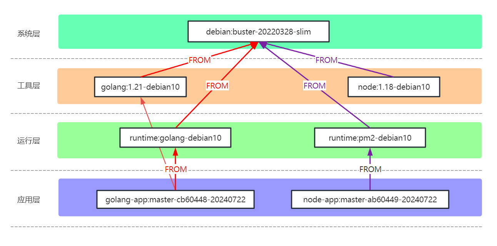
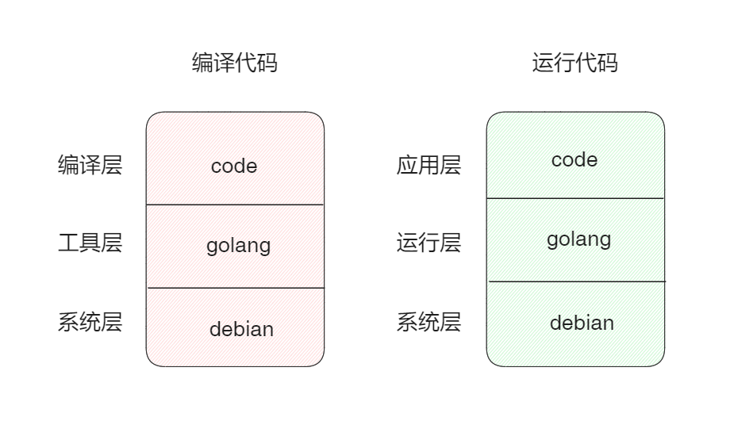

# 设计篇：Dockerfile 设计原则与镜像管理规范

良好的设计是高效、规范使用 Docker 的基石。本篇将深入探讨 Dockerfile 设计的核心原则，并结合中小企业实践，介绍一套关于镜像逻辑分层、命名、存储及 Dockerfile 文件管理的推荐规范。理解这些原则和规范，将帮助你的团队构建出更优化、更易于管理的 Docker 镜像。

## 一、理解 Docker 镜像的技术分层与缓存

在设计 Dockerfile 之前，首先要理解 Docker 镜像是如何构建和存储的。这对于编写高效的 Dockerfile 至关重要。

**核心概念：**

1.  **镜像是分层的 (Layered):** Docker 镜像由一系列**只读层 (Read-only Layers)** 叠加而成。Dockerfile 中的每一条**能修改文件系统**的指令（如 `RUN`, `COPY`, `ADD`）通常会创建一个新的镜像层。
2.  **共享与复用:** 如果多个镜像共享相同的基础层，Docker 只需要在磁盘上存储一份该层，节省了大量空间。
3.  **写时复制 (Copy-on-Write):** 当基于镜像启动一个容器时，Docker 会在只读镜像层之上添加一个**可写的容器层 (Container Layer)**。当容器需要修改某个文件时：
    - 如果文件在下层（只读层），Docker 会将该文件**复制**到最上层的可写容器层，然后进行修改。下层的原始文件保持不变。
    - 如果文件只存在于容器层（新创建的文件），则直接在容器层操作。
    - 删除文件时，也是在容器层记录一个"删除标记"，下层的文件并未真正移除。
4.  **构建缓存 (Build Cache):** Docker 在构建镜像时会利用缓存。如果 Dockerfile 的某一行指令及其依赖的文件没有发生变化，Docker 会直接**复用之前构建好的镜像层**，而不是重新执行该指令。这可以**极大地加快**镜像构建速度。

**这对 Dockerfile 设计的启发：**

- **尽量减少层数:** 因为每一层都有额外的元数据开销，并且过多的层可能影响性能。可以通过**合并 `RUN` 指令**来实现：

  ```dockerfile
  # 不推荐：创建了两个层
  RUN apt-get update
  RUN apt-get install -y nginx

  # 推荐：只创建一个层
  RUN apt-get update && apt-get install -y nginx && apt-get clean && rm -rf /var/lib/apt/lists/*
  # 注意：同时清理缓存以减小该层体积
  ```

- **优化指令顺序:** 将**不经常变动**的指令放在前面（如安装基础软件包），将**经常变动**的指令放在后面（如 `COPY` 应用程序代码）。这样可以最大限度地利用构建缓存。

  ```dockerfile
  # 不推荐：代码变动会导致 npm install 缓存失效
  COPY . /app
  WORKDIR /app
  RUN npm install

  # 推荐：先拷贝 package.json 并安装依赖，再拷贝代码
  WORKDIR /app
  COPY package*.json ./
  RUN npm install # 只有 package*.json 变化时才重新执行
  COPY . . # 代码变化只会让 COPY . . 缓存失效
  ```

- **谨慎选择 `COPY` 和 `ADD` 的源:** 只 `COPY` 或 `ADD` 必要的文件。使用 `.dockerignore` 文件排除不需要复制的文件。

## 二、中小企业镜像逻辑分层策略 (推荐实践)

除了 Docker 的技术分层，我们可以在此基础上设计一套**逻辑分层策略**，来规范和组织企业内部的基础镜像，提高复用性并明确职责。以下是一种推荐的四层模型：

1.  **系统层 (OS Layer):**
    - **目的:** 提供最基础、最稳定的操作系统环境。
    - **内容:** 选择一个标准的基础 OS 镜像（如 `debian:bullseye-slim`, `alpine:latest`），进行必要的初始化设置，安装极少数通用工具（如 `ca-certificates`, `tzdata`，或许有 `curl`, `wget` 但尽量精简）。
    - **特点:** 极少变动，稳定性要求最高，体积尽可能小。
    
2.  **工具层 (Tools Layer):**

    - **目的:** 在系统层之上，安装特定类型的**通用工具或环境**，供多个应用或服务复用。
    - **内容:** 例如，安装特定版本的 Go 编译环境 (`golang:1.21-bullseye`)、Node.js 环境 (`node:18-bullseye`)、Python 环境、或者运维常用的工具集（如包含 `kubectl`, `helm`, `terraform` 的镜像）。
    - **特点:** 相对稳定，按需构建，服务于特定技术栈或场景。

3.  **运行层 (Runtime Layer):**

    - **目的:** 提供应用程序**运行所需**的环境，通常不包含编译工具。
    - **内容:** 对于编译型语言（如 Go, Java），这层通常只包含基础 OS + 必要的运行时库。对于解释型语言（如 Node.js, Python），这层可能与工具层相似或在其上添加特定运行时依赖（如 `pm2` for Node.js）。也可以包含应用运行所需的通用依赖（如某个 Web 服务器配置、特定的系统库）。
    - **特点:** 专注于"运行"，尽可能轻量，不含编译工具链。

4.  **应用层 (Application Layer):**
    - **目的:** 将应用程序代码或构建产物打包到对应的运行层镜像中。
    - **内容:** 主要是应用程序本身的文件（代码、编译后的二进制、静态资源）和应用特定的配置。
    - **特点:** 变动最频繁，通常由各个业务团队维护，直接用于部署。**`Dockerfile` 通常放在应用程序的代码仓库中。**

 _(示意图：展示了四层逻辑关系)_

**结合多阶段构建 (Multi-stage Builds):**

对于编译型语言（如 Go），多阶段构建是实现上述逻辑分层的关键技术。它允许你在一个 Dockerfile 中使用多个 `FROM` 指令：

- **第一阶段 (编译阶段):** 使用包含编译环境的**工具层**镜像（如 `golang:1.21`），编译代码。
- **第二阶段 (运行阶段):** 使用轻量级的**运行层**镜像（如 `debian:bullseye-slim` 或自定义的 Go 运行层），从编译阶段 `COPY --from=<编译阶段名>` 编译好的二进制文件。

这样最终的应用镜像只包含运行所需的最小文件集，体积大大减小。

**Go 应用示例：**

 

(示意图：Go 应用的多阶段构建流程)

```dockerfile
# ---- 编译阶段 (使用工具层镜像) ----
FROM golang:1.21-bullseye AS builder
WORKDIR /src
COPY go.mod go.sum ./
RUN go mod download
COPY . .
RUN CGO_ENABLED=0 GOOS=linux go build -o /app .

# ---- 运行阶段 (使用运行层镜像) ----
FROM debian:bullseye-slim # 或者你们自定义的极简运行层
WORKDIR /app
COPY --from=builder /app /app # 从编译阶段拷贝二进制文件
# COPY config.yaml . # (可选) 拷贝必要的配置文件

EXPOSE 8080
CMD ["/app"]
```

> **中小企业价值:** 这套逻辑分层和多阶段构建实践，有助于：
>
> - **标准化:** 统一基础环境，减少环境差异。
> - **效率:** 复用基础镜像，加快构建和部署速度。
> - **安全:** 减小攻击面，易于管理基础镜像的漏洞。
> - **协作:** 不同团队可以专注于自己负责的层级。

## 三、镜像命名与版本管理规范

清晰、一致的命名和版本标签对于镜像管理至关重要。

**格式建议:** `<仓库名>/<镜像名>:<标签>`

**命名 (`<镜像名>`) 建议:**

- **系统层:** 通常直接使用 OS 名称，如 `debian`, `alpine`。
- **工具/运行层:** 体现其主要功能，如 `golang`, `node`, `python`, `nginx`。
- **应用层:** 使用应用服务的名称，如 `user-service`, `product-api`, `frontend-web`。

**标签 (`<标签>`) 建议:**

- **区分大版本与小版本:**
  - **系统层:** `11.10-slim`, `11-slim`。`11-slim` 作为稳定大版本供下游引用，`11.10-slim` 记录具体小版本。
  - **工具/运行层:** `1.21.12-debian11`, `1.21-debian11`。`1.21-debian11` 作为稳定大版本引用，标签中包含工具版本和依赖的基础 OS 版本。
- **应用层:** 包含能追溯来源的信息，一种常用格式：
  `[代码分支]-[短哈希]-[构建时间戳]`
  例如：`master-a0e6b99-202406241011`, `develop-b1c8f2a-202408031530`
  - `代码分支` (如 master, develop, feature-xyz)
  - `短哈希` (Git commit short hash)
  - `构建时间戳` (YYYYMMDDHHMM)
    这样可以清晰地知道镜像是基于哪个分支、哪个代码版本、何时构建的。

## 四、镜像存储与管理实践 (以 Harbor 为例)

大多数企业会使用私有的 Docker Registry 来存储镜像，[Harbor](https://goharbor.io/) 是一个流行的开源选择。以下是基于 Harbor 的项目划分和管理策略示例：

**Harbor 项目 (Project) 划分建议：**

```
/
├── library/      # 存储从 Docker Hub 等公共仓库同步的官方镜像，只读。
├── common/       # 存储企业内部通用的基础镜像 (系统层、工具层、运行层)
│   ├── os/debian:bullseye-slim
│   ├── tools/golang:1.21-bullseye
│   ├── tools/node:18-bullseye
│   └── runtime/golang:1.0-debian11
├── dev/          # 存储开发环境的应用镜像
│   └── user-service:develop-a1b2c3d-202408011000
├── test/         # 存储测试环境的应用镜像
│   └── user-service:release-d4e5f6a-202408021400
└── prod/         # 存储生产环境的应用镜像
│   └── user-service:master-b7c8d9e-202408031800
```

**说明:**

- `library`: 作为公共镜像的本地缓存，减少对外部网络的依赖。

- `common`: 存放标准化、可复用的基础镜像，由基础架构团队或指定人员维护。

- `dev`, `test`, `prod`: 按环境划分应用镜像。

  > 按环境划分的优势点
  >
  > - **权限控制:** 可以设置不同环境的 K8s 集群只能拉取对应环境的镜像（如生产集群不能拉取 `dev` 镜像）。
  > - **生命周期管理:** 可以设置不同项目的镜像保留策略（如 `dev` 镜像保留 3 天，`test` 保留 7 天，`prod` 保留 90 天），节省存储空间。

## 五、Dockerfile 文件管理策略 (使用 Git)

管理企业内众多的基础镜像 Dockerfile 也需要规范。推荐使用 [Git](https://git-scm.com/) 进行版本控制。

**Git 仓库目录结构建议:**

创建一个专门的 Git 仓库（例如命名为 `dockerfiles-base` 或 `infra-dockerfiles`）来管理 Dockerfile。

```bash
dockerfiles-base/
├── common/
│   ├── os/
│   │   └── debian/             # 对应 common/os/debian 镜像
│   │       ├── bullseye-slim/
│   │       │   ├── Dockerfile  # DockerFile
│   │       │   └── build.sh    # 构建脚本
│   │       └── bookworm-slim/
│   │           ├── Dockerfile
│   │           └── build.sh
│   ├── tools/
│   │   ├── golang/             # 对应 common/tools/golang 镜像
│   │   │   ├── Dockerfile
│   │   │   └── build.sh
│   │   └── node/               # 对应 common/tools/node 镜像
│   │       ├── Dockerfile
│   │       ├── scripts/        # (可选) 需要 COPY 的额外文件
│   │       └── build.sh
│   └── runtime/
│       ├── golang/             # 对应 common/runtime/golang 镜像
│       │   ├── Dockerfile
│       │   └── build.sh
│       └── nginx/              # 对应 common/runtime/nginx 镜像
│           ├── Dockerfile
│           ├── nginx.conf
│           └── entrypoint.sh
└── README.md                   # 说明文档
```

**说明:**

- 目录结构与 Harbor 项目结构保持一致，清晰明了。
- 按镜像名和版本（标签）组织目录。
- 每个目录下包含 `Dockerfile` 和可能的构建脚本、配置文件等。
- **应用层 (Application Layer) 的 Dockerfile 通常放在各自应用程序的代码仓库中**，因为它们与应用代码紧密相关。这个公共仓库主要管理**基础镜像**的 Dockerfile。

**如何扩展？**

如果某个应用（比如 `app-A`）需要一个基于 `common/runtime/golang:1.0-debian11` 但额外安装了 `git` 的运行环境：

1.  **选项一 (推荐):** 在 `app-A` 的代码仓库中的 Dockerfile 里，直接 `FROM common/runtime/golang:1.0-debian11`，然后 `RUN apt-get update && apt-get install -y git`。这是最常见的做法。
2.  **选项二 (如果多处需要):** 如果很多应用都需要这个带 `git` 的 Go 运行环境，可以在 `dockerfiles-base` 仓库的 `common/runtime/` 下创建一个新的镜像定义，例如 `golang-git/Dockerfile`，内容是 `FROM common/tools/golang:debian11` 加上安装 `git` 的指令。然后构建并推送到 Harbor 的 `common/runtime/golang-git:1.0-debian11`。

---

遵循这些设计原则和管理规范，可以帮助中小企业团队更有序、更高效地构建和管理 Docker 镜像，为后续的 CI/CD 和容器化部署打下坚实的基础。
