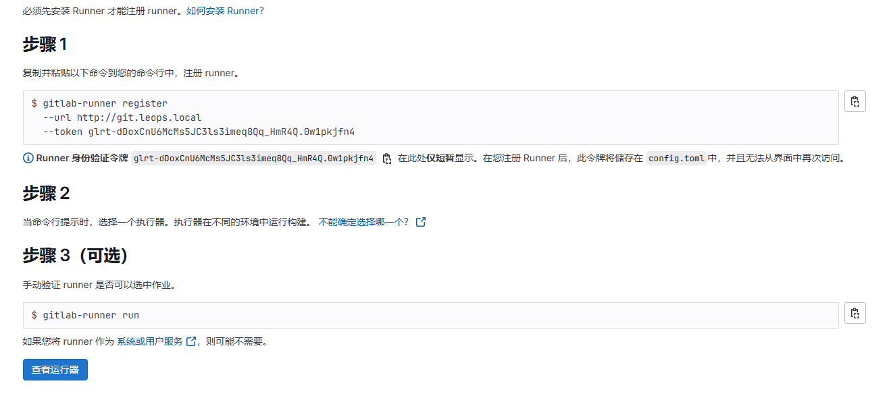

# 实践篇：部署代码仓库

代码仓库是 DevOps 工作流的起点，用于存储、版本控制和协作开发我们的应用程序代码及 Dockerfile。[Gitlab](https://about.gitlab.com/) 是一个功能非常强大的、开源的代码托管平台，除了核心的 Git 仓库管理，还集成了 CI/CD、问题跟踪、Wiki 等众多功能。

**注意:** Gitlab 功能强大，但资源消耗也相对较高（特别是内存）。对于资源有限的环境或仅需核心 Git 功能的场景，可以考虑更轻量级的替代方案，如 [Gitea](https://gitea.io/)。

本篇将指导你如何使用 Docker Compose 部署一个**简化版**的 Gitlab Community Edition (CE)，侧重于核心的代码仓库功能，并使用 **HTTP** 访问，方便快速入门和学习。

**环境说明:**

- **准备篇"路径二：模拟企业环境"用户:** 请确保 hosts 文件中 `git.leops.local` 指向你的服务器 IP。后续配置中可以将 `http://localhost` 替换为 `http://git.leops.local`。
- **准备篇"路径一：本地学习环境"用户:** 你将使用 `http://localhost` 或 `http://<你的IP>` 来访问 Gitlab。

## 一、准备目录和 Docker Compose 文件

1.  **创建 Gitlab 数据目录:**
    ```bash
    # 切换到合适的安装目录，例如 /data
    cd /data
    # 创建用于持久化 Gitlab 配置、日志和数据的目录
    mkdir -p gitlab/config gitlab/logs gitlab/data gitlab/runner
    cd gitlab
    ```
2.  **创建 `docker-compose.yml` 文件:**

    ```yaml
    services:
    gitlab:
      image: 'gitlab/gitlab-ce:17.11.0-ce.0'
      container_name: gitlab
      restart: always
      hostname: 'git.leops.local'
      environment:
        TZ: 'Asia/Shanghai'
        GITLAB_OMNIBUS_CONFIG: |
          external_url 'http://git.leops.local'
          gitlab_rails['time_zone'] = 'Asia/Shanghai'
      ports:
        - '8081:80'
        - '2222:22'
      volumes:
        - ./config:/etc/gitlab
        - ./logs:/var/log/gitlab
        - ./data:/var/opt/gitlab
        - /usr/share/zoneinfo/Asia/Shanghai:/etc/localtime:ro
      shm_size: '256m'
    gitlab-runner:
      image: gitlab/gitlab-runner:alpine3.19-v17.11.0
      restart: always
      container_name: gitlab-runner
      environment:
        CI_SERVER_URL: http://gitlab
        TZ: 'Asia/Shanghai'
      volumes:
        - ./runner:/etc/gitlab-runner
        - ./runner-cache:/cache
        - /var/run/docker.sock:/var/run/docker.sock:rw
        - /etc/localtime:/etc/localtime:ro
    ```

**配置解释:**

- `image`: 指定了 Gitlab CE 的 Docker 镜像。建议使用明确的版本号。
- `hostname`: 容器的主机名，`external_url` 中的域名应能解析到运行 Docker 的主机。
- `GITLAB_OMNIBUS_CONFIG`: 用于配置 Gitlab 内部服务的关键部分。
  - `external_url`: **极其重要！** 必须设置为用户访问 Gitlab 时使用的 URL (包含 `http://`)。Gitlab 会基于此 URL 生成仓库克隆地址等。路径一用户请使用 `http://localhost` 或 `http://<你的IP>`。路径二用户使用 `http://git.leops.local`。
- `ports`: 只映射了 HTTP 端口 80。如果需要通过 SSH 访问 Git 仓库，使用 `ssh://git@<hostname>:2222/...` 的方式克隆。
- `volumes`: 将 Gitlab 的配置、日志和数据持久化到宿主机的 `./config`, `./logs`, `./data` 目录中，非常重要！
- `shm_size`: Gitlab 可能需要较大的共享内存，如果遇到性能问题可以尝试增加此值（如 `1gb`, `2gb`）。

## 二、启动 Gitlab

在包含 `docker-compose.yml` 文件的目录 (`/data/gitlab`) 中执行：

```bash
sudo docker compose up -d
```

首次启动 Gitlab 需要一些时间来完成初始化配置。你可以使用 `sudo docker compose logs -f gitlab` 来观察启动日志。当看到类似 `gitlab Reconfigured!` 的信息时，表示基本就绪。

**资源提示:** Gitlab CE 至少需要 2 核 CPU 和 4GB 可用内存才能流畅运行。如果你的机器配置较低，启动和运行可能会很慢。

## 三、Nginx 代理配置

在 `/data/nginx/nginx_data/conf.d` 目录下创建一个 `gitlab.conf` 文件：

```nginx
server {
    listen 80;
    server_name git.leops.local;

    access_log /var/log/nginx/git_access.log;
    error_log /var/log/nginx/git_error.log;

    location / {
        proxy_pass http://192.168.77.140:8081;
        proxy_set_header  Host              $http_host;
        proxy_set_header  X-Real-IP         $remote_addr;
        proxy_set_header  X-Forwarded-For   $proxy_add_x_forwarded_for;
        proxy_set_header  X-Forwarded-Proto $scheme;

        proxy_buffering off;
        proxy_request_buffering off;

        proxy_send_timeout 900;
        proxy_read_timeout 900;
    }
}
```

重载 Nginx 配置：

```bash
docker exec nginx-proxy sh -c "nginx -t && nginx -s reload"
```

## 四、首次登录和基本设置

1.  **获取初始 root 密码:** Gitlab 启动后，初始的 `root` 用户密码存储在一个临时文件中。通过以下命令查看：
    ```bash
    # 等待 Gitlab 完全启动后再执行 (可能需要几分钟)
    sudo docker exec gitlab cat /etc/gitlab/initial_root_password
    ```
    复制输出的文件内容，找到其中的密码 (Password)。**这个文件只在首次配置后 24 小时内有效。**
2.  **登录 Gitlab:**
    - 在浏览器中访问你配置的 `external_url` (例如 `http://localhost` 或 `http://git.leops.local`)。
    - 使用用户名 `root` 和上面获取的密码登录。
3.  **修改 root 密码:** 首次登录后，强烈建议立即修改 `root` 用户的密码。点击右上角的用户头像 -> Edit profile -> Password。
4.  **(可选) 关闭注册:** 如果你不希望任何人都能注册账号，可以在管理中心关闭注册。Admin Area -> Settings -> General -> Sign-up restrictions，取消勾选 "Sign-up enabled"。

## 四、基本 Git 操作示例

1.  **创建新项目:**
    - 登录 Gitlab 后，点击 "New project" -> "Create blank project"。
    - 输入项目名称（如 `my-first-app`），选择可见性级别 (Private/Public)，然后点击 "Create project"。
2.  **配置本地 Git (如果首次使用):**
    打开你的终端或 Git Bash，设置你的用户名和邮箱：
    ```bash
    git config --global user.name "Your Name"
    git config --global user.email "youremail@example.com"
    ```
3.  **克隆仓库:** 在 Gitlab 项目页面，复制项目的 HTTP 克隆地址 (例如 `http://localhost/root/my-first-app.git`)。
    ```bash
    # 切换到你存放代码的目录
    cd ~/projects
    git clone http://localhost/root/my-first-app.git
    cd my-first-app
    ```
    _(如果使用 SSH 方式，需要先在 Gitlab 中添加你的 SSH 公钥，并使用 SSH 克隆地址)_
4.  **添加、提交和推送文件:**

    ```bash
    # 创建一个 README 文件
    echo "# My First App" > README.md

    # 添加到 Git 暂存区
    git add README.md

    # 提交到本地仓库
    git commit -m "Add README"

    # 推送到 Gitlab 远程仓库 (main 分支)
    git push -u origin main
    ```

    刷新 Gitlab 项目页面，你应该能看到 `README.md` 文件了。

### 五、配置 GitLab Runner

GitLab Runner 是 GitLab CI/CD 的执行器，负责运行您在 .gitlab-ci.yml 文件中定义的作业。以下是配置流程：

1. 获取注册令牌

   - 登录 GitLab 管理员账户
   - 进入 管理中心（Admin Area）
   - 导航至 概览 > Runners
   - 注意页面上的注册令牌（Registration token）

   

2. 注册 GitLab Runner

```bash
docker exec gitlab-runner gitlab-runner register --non-interactive --url http://gitlab --registration-token glrt-dDoxCnU6McMs5JC3ls3imeq8Qq_HmR4Q.0w1pkjfn4 --executor docker --description "docker-runner" --docker-image python:3 --docker-volumes "/cache:/cache" --docker-volumes "/var/run/docker.sock:/var/run/docker.sock" --docker-pull-policy "always" --docker-shm-size 0
```

## 五、Gitlab 常用维护命令 (在容器内执行)

以下命令需要在 Gitlab 容器内部通过 `docker compose exec gitlab <command>` 执行：

```bash
# 启动所有 gitlab 组件 (通常不需要手动执行，由 docker compose 管理)
sudo docker compose exec gitlab gitlab-ctl start

# 停止所有 gitlab 组件
sudo docker compose exec gitlab gitlab-ctl stop

# 重启所有 gitlab 组件
sudo docker compose exec gitlab gitlab-ctl restart

# 查看服务状态
sudo docker compose exec gitlab gitlab-ctl status

# 使配置文件 (/etc/gitlab/gitlab.rb, 但我们通过环境变量配置) 生效
sudo docker compose exec gitlab gitlab-ctl reconfigure

# 运行健康检查
sudo docker compose exec gitlab gitlab-rake gitlab:check SANITIZE=true --trace

# 查看日志
sudo docker compose logs -f gitlab

# 或者查看特定服务的日志
sudo docker compose exec gitlab gitlab-ctl tail nginx
```

---

现在，你已经成功部署了一个基本的 Gitlab 代码仓库，并了解了如何进行基本操作。你可以开始创建项目，管理你的代码和 Dockerfile 了！对于更高级的配置（如 HTTPS, LDAP, CI/CD Runner），请参考 Gitlab 官方文档。
