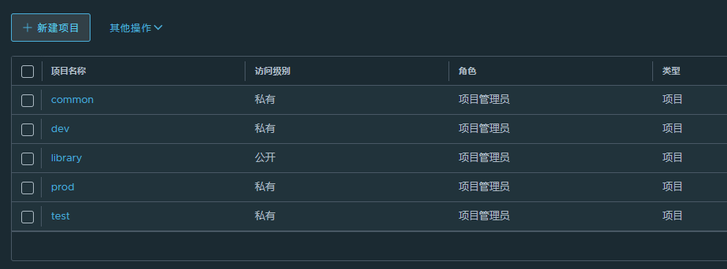

# 实践篇：部署镜像仓库 (Harbor)

在企业内部，拥有一个私有的 Docker 镜像仓库至关重要。它用于存储我们构建的标准化基础镜像和应用程序镜像，实现镜像的安全管理、版本控制和快速分发。[Harbor](https://goharbor.io/) 是一个流行的、开源的企业级 Docker Registry 解决方案，提供了用户管理、访问控制、安全扫描 (集成 Trivy)、镜像复制等丰富功能。

本篇将指导你如何部署 Harbor。

**环境说明:**

- **如果你选择了准备篇的"路径二：模拟企业环境":** 请确保已在服务器和本地机器的 hosts 文件中添加了 `harbor.leops.local` 指向你的服务器 IP。
- **如果你选择了准备篇的"路径一：本地学习环境":** 你可以使用 `localhost` 或你的 Docker 主机 IP 地址来访问 Harbor。下文配置中需要将 `harbor.leops.local` 替换为相应的值。同时，你可能需要在 Docker 客户端配置 `insecure-registries` 来允许通过 HTTP 访问你的 Harbor 实例（或者配置 HTTPS，但这更复杂）。

## 一、下载并解压 Harbor 安装包

Harbor 提供在线和离线两种安装方式。这里我们使用**离线安装包**，它包含了运行 Harbor 所需的所有 Docker 镜像。

1.  **访问 Harbor Releases 页面:** [https://github.com/goharbor/harbor/releases](https://github.com/goharbor/harbor/releases)
2.  **选择版本:** 找到最新的稳定版本（例如 `v2.11.2` 或更新版本），下载对应的 `harbor-offline-installer-vx.y.z.tgz` 文件。

    ```bash
    # 切换到合适的安装目录，例如 /data
    cd /data
    
    # 下载 (请替换为最新稳定版本链接)
    wget https://github.com/goharbor/harbor/releases/download/v2.13.0/harbor-offline-installer-v2.13.0.tgz
    
    # 解压
    tar zxvf harbor-offline-installer-v2.13.0.tgz
    
    # 进入解压后的目录 (目录名可能与版本号相关)
    cd harbor
    ```

    > 注意: 如果你在中国大陆，下载速度可能较慢，可以考虑使用 https://ghfast.top 代理下载。

## 二、配置 Harbor

Harbor 的配置通过修改 `harbor.yml` 文件完成。

1.  **复制配置文件模板:**
    ```bash
    cp harbor.yml.tmpl harbor.yml
    ```
2.  **修改 `harbor.yml`:** 使用文本编辑器打开 `harbor.yml`，至少修改以下关键配置：

    ```yaml
    http:
      port: 8080

    # 注意，这里不需要HTTPS，所以要注释掉 HTTPS 部分。
    # https:
    #   port: 443
    #   certificate: /your/certificate/path
    #   private_key: /your/private/key/path

    # Harbor 的访问地址 (域名或 IP)
    hostname: harbor.leops.local # 路径二用户使用域名; 路径一用户使用 localhost 或 IP

    # Harbor 的外部访问 URL (协议 + 主机名)
    # 如果不打算配置 HTTPS，保持 http。路径一用户同样修改域名部分。
    external_url: http://harbor.leops.local

    # Harbor 管理员 (admin) 的初始密码 (!!务必修改为强密码!!)
    harbor_admin_password: Harbor12345

    # 数据库内部使用的密码 (!!建议修改为强密码!!)
    database:
      password: root123

    # Harbor 存储镜像等数据的路径 (确保存储空间足够)
    data_volume: /data/harbor/harbor_data # 确保 /data/harbor 目录存在或有权限创建

    # 其他配置可以暂时保持默认
    ```

    **重要提示 (路径一用户):** 如果你使用 `localhost` 或 IP，并且没有配置 HTTPS，你需要告诉你的 Docker 客户端信任这个 HTTP Registry。编辑 Docker 的 `daemon.json` 文件 (Linux: `/etc/docker/daemon.json`, Docker Desktop: Settings -> Docker Engine)，添加 `insecure-registries` 配置，然后重启 Docker 服务：

    ```json
    {
      "insecure-registries": ["harbor.leops.local"]
      // ... 其他配置，如 registry-mirrors ...
    }
    ```

3.  **安装 Harbor:** `install.sh` 脚本会根据 `harbor.yml` 生成部署所需的 `docker-compose.yml` 等文件。
    ```bash
    # --with-trivy 表示同时启用内置的 Trivy 镜像扫描功能
    bash ./install.sh --with-trivy
    ```
    > 只有首次安装时需要执行 `install.sh`，后续升级或修改配置只需执行 `./prepare --with-trivy && docker compose up -d` 即可。

## 三、启动 Harbor

使用 `docker compose` (或旧版的 `docker-compose`) 启动 Harbor 服务。

```bash
sudo docker compose up -d
```

等待所有容器启动完成。你可以使用 `docker compose ps` 查看状态。

## 四、配置 Trivy 镜像扫描 (可选优化)

Trivy 用于扫描镜像中的安全漏洞。默认情况下，它会从 GitHub 等源更新漏洞数据库。如果你的服务器访问这些源速度慢，可以配置国内镜像源。

1.  **修改 Trivy 环境变量:** 编辑 `common/config/trivy-adapter/env` 文件 (注意：这个文件是在执行 `./prepare` 后生成的)。
    ```bash
    # 在文件末尾追加以下内容 (如果已有则修改)
    vim common/config/trivy-adapter/env
    ```
    添加或修改以下行：
    ```env
    SCANNER_TRIVY_DB_REPOSITORY=ghcr.nju.edu.cn/ghcr.io/aquasecurity/trivy-db,m.daocloud.io/ghcr.io/aquasecurity/trivy-db,ghcr.io/aquasecurity/trivy-db
    SCANNER_TRIVY_JAVA_DB_REPOSITORY=ghcr.nju.edu.cn/ghcr.io/aquasecurity/trivy-java-db,m.daocloud.io/ghcr.io/aquasecurity/trivy-java-db,ghcr.io/aquasecurity/trivy-java-db
    ```
2.  **重启 Trivy 相关服务使配置生效:**
    ```bash
    sudo docker compose restart trivy-adapter core
    ```
    _注意: Harbor 版本不同，需要重启的服务可能略有差异，通常重启 `trivy-adapter` 和 `core` 服务即可。_

**(进阶) Trivy 离线扫描配置:**
如果你的 Harbor 完全无法访问外网，可以配置 Trivy 进行离线扫描。

1.  **修改 `harbor.yml`:** 添加或修改 `trivy` 配置部分：
    ```yaml
    trivy:
      skip_update: true # 关闭在线更新缺陷数据库
      skip_java_db_update: true # 关闭在线更新java缺陷数据库
      # offline_scan: true # 在较新版本中，此选项可能不再需要，skip_update 已足够
    ```
2.  **重新执行 `./prepare`:** `sudo ./prepare --with-trivy`
3.  **手动下载数据库:** 在一台可以访问网络的机器上下载数据库文件，然后传输到 Harbor 服务器。或者在 Harbor 服务器上临时配置网络代理下载：
    ```bash
    # 确保 Harbor 容器已启动
    # 下载主数据库
    sudo docker exec trivy-adapter trivy image --download-db-only --db-repository ghcr.nju.edu.cn/ghcr.io/aquasecurity/trivy-db
    # 下载 Java 数据库
    sudo docker exec trivy-adapter trivy image --download-java-db-only --java-db-repository ghcr.nju.edu.cn/ghcr.io/aquasecurity/trivy-java-db
    ```
4.  **重启服务:** `sudo docker compose up -d` (或重启 `trivy-adapter` 和 `core`)。

## 五、配置 Nginx 代理

在 `/data/nginx/nginx_data/conf.d` 目录下创建一个 `harbor.conf` 文件：

```nginx
server {
    listen 80;
    server_name harbor.leops.local;

    access_log /var/log/nginx/harbor_access.log;
    error_log /var/log/nginx/harbor_error.log;

    location / {
        proxy_pass http://192.168.77.140:8080;
        proxy_set_header Host $host;
        proxy_set_header X-Real-IP $remote_addr;
        proxy_set_header X-Forwarded-For $proxy_add_x_forwarded_for;
        proxy_set_header X-Forwarded-Proto $x_forwarded_proto;

        proxy_buffering off;
        proxy_request_buffering off;

        proxy_send_timeout 900;
        proxy_read_timeout 900;
    }
}
```

重载 Nginx 配置：

```bash
docker exec nginx-proxy sh -c "nginx -t && nginx -s reload"
```

## 六、访问和使用 Harbor

1.  **登录 Harbor UI:**
    - 在浏览器中访问你在 `harbor.yml` 中配置的 `external_url` (例如 `http://harbor.leops.local` 或 `http://localhost`)。
    - 使用用户名 `admin` 和你设置的 `harbor_admin_password` 登录。
2.  **创建项目 (Project):**
    - 登录后，点击"项目" -> "新建项目"。
    - 根据我们在设计篇的规划，创建以下项目：
      - `common`: 用于存放通用的基础镜像 (系统层、工具层、运行层)。设置为**公开**项目，方便拉取。
      - `dev`: 用于存放开发环境的应用镜像。可以设置为**私有**。
      - `test`: 用于存放测试环境的应用镜像。可以设置为**私有**。
      - `prod`: 用于存放生产环境的应用镜像。可以设置为**私有**。
      
      
3.  **从 Docker CLI 登录 Harbor:**

    ```bash
    # 使用你在 harbor.yml 中配置的 hostname
    docker login harbor.leops.local
    # 或者 (路径一用户)
    # docker login localhost
    # docker login <你的IP>

    # 输入用户名: admin
    # 输入密码: <你设置的 harbor_admin_password>
    ```

4.  **推送镜像示例:**

    ```bash
    # 1. 给镜像打上 Harbor 的标签 (格式: <harbor_hostname>/<项目名>/<镜像名>:<标签>)
    docker tag nginx:1.27-alpine harbor.leops.local/library/nginx:1.27-alpine
    
    # 2. 推送镜像到 Harbor 的 library 项目
    docker push harbor.leops.local/library/nginx:1.27-alpine
    ```
    
5.  **从 Harbor 拉取镜像:**
    
    ```bash
    docker pull harbor.leops.local/library/nginx:1.27-alpine
    ```

## 六、Harbor 日常维护 (简介)

- **项目保留策略 (Image Retention):** 在项目设置中配置，可以按时间、数量保留镜像，自动清理旧镜像，节省空间。可以配置排除特定标签（如 `latest`）或保留无 Tag 的镜像。
- **系统清理服务 (Garbage Collection):** 在系统管理中配置，定期运行 GC 可以回收项目保留策略删除的镜像层所占用的磁盘空间。

更多关于 Harbor 的使用和管理，请参考 [Harbor 官方文档](https://goharbor.io/docs/)。

---

现在，你已经拥有了一个功能强大的私有镜像仓库，可以开始存储和管理你的 Docker 镜像了！
