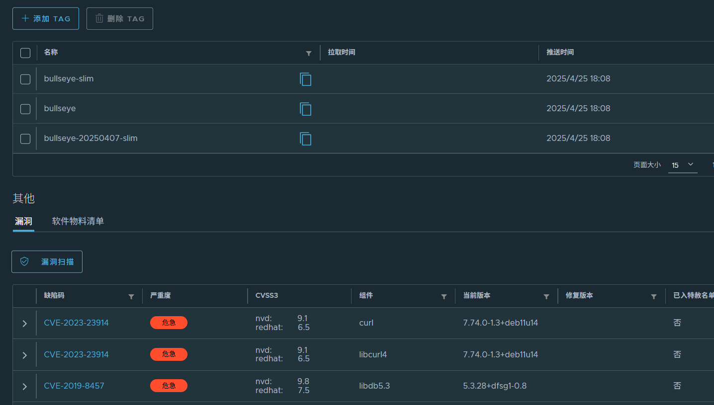
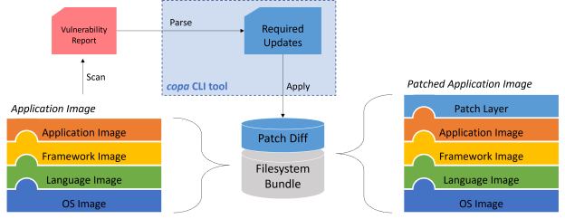

# 进阶篇：扫描与修复 Docker 镜像漏洞

选一个实际可访问的镜像，先在 Harbor 或 Trivy CLI 中找出受影响的包、已安装版本和修复版本，再决定如何更新。随后重新扫描修补后的镜像，并验证应用能正常运行。

## 一、理解镜像漏洞

扫描器识别镜像里的软件包和版本，并与已知漏洞数据库比对。漏洞报告中的 CVE ID 用于查询对应的漏洞详情。

- **操作系统软件包**。例如 Debian 或 Alpine 中的 `libc`、`openssl`、`curl`。通常从基础镜像或系统包入手。来不及重建时，可使用本章的 Copacetic 示例修补有可用更新的包。
- **应用依赖**。例如 Python 的 `pip` 包、Node.js 的 `npm` 包、Java 的 Maven 或 Gradle 依赖。更新应用依赖后重新构建镜像。

## 二、使用 Trivy 进行漏洞扫描

Trivy 可以扫描容器镜像、文件系统和 Git 仓库。已推送的镜像可在 Harbor 中查看扫描结果。在本地构建、生成 JSON 报告或接入流水线时，使用 Trivy CLI。[Trivy 项目](https://github.com/aquasecurity/trivy)

### 1. 通过 Harbor UI 查看扫描结果 (推荐)

先确认 Harbor 已按第 32 章启用 Trivy，再选择一个已推送的镜像。[部署镜像仓库](32.实战篇-部署镜像仓库.md)

1. 登录 Harbor，打开镜像所属项目（如 `common` 或 `dev`），进入相应仓库（如 `common/os/debian`）。
2. 选择要检查的标签（如 `bullseye-20250407-slim`），打开 **漏洞**（Vulnerabilities）页。启用推送时自动扫描后，新镜像推送会触发扫描。也可以在镜像详情页手动触发。
3. 先按严重性定位 Critical 和 High（报告还可能显示 Medium、Low、Unknown）。查看软件包、当前版本和修复版本，需要了解触发条件时打开 CVE 详情，例如 NVD 的漏洞记录。



修复版本有值时，用它核对升级后的版本。字段为空或显示 `wont-fix`、`not-fixed` 时，按本章第五节评估缓解措施和例外。

### 2. 使用 Trivy CLI (本地或 CI/CD)

1.  安装 Trivy 并准备漏洞数据库。以下用 Linux amd64 的 Debian 安装包演示。也可以使用 `brew install trivy`、下载二进制文件或使用容器镜像。[Trivy 安装文档](https://trivy.dev/latest/getting-started/installation/)

    ```bash
    wget https://github.com/aquasecurity/trivy/releases/download/v0.62.1/trivy_0.62.1_Linux-64bit.deb
    sudo dpkg -i trivy_0.62.1_Linux-64bit.deb
    trivy --version

    # 更新 Trivy 数据库 (使用南京大学的镜像源 ghcr.nju.edu.cn/ghcr.io 加速国内访问)
    trivy image --download-db-only --db-repository ghcr.nju.edu.cn/ghcr.io/aquasecurity/trivy-db
    trivy image --download-java-db-only --java-db-repository ghcr.nju.edu.cn/ghcr.io/aquasecurity/trivy-java-db
    ```

2.  扫描同一个镜像。下面的命令分别用于查看全部结果、筛选漏洞、设置流水线退出状态和导出报告，按需单独执行。

    ```bash
    # 将镜像地址替换为本地或远程仓库中实际存在的引用
    IMAGE="harbor.leops.local/common/os/debian:bullseye-20250407-slim"
    trivy image --scanners vuln "$IMAGE"

    # 只显示高危和严重漏洞
    trivy image --scanners vuln --severity HIGH,CRITICAL "$IMAGE"

    # 忽略未修复的漏洞 (方便聚焦可操作项)
    trivy image --scanners vuln --ignore-unfixed "$IMAGE"

    # 在 CI/CD 中使用：如果发现高危或严重漏洞则构建失败
    trivy image --scanners vuln --severity HIGH,CRITICAL --exit-code 1 "$IMAGE"

    # 输出为 JSON 格式 (方便机器处理)
    trivy image --scanners vuln --format json -o report.json "$IMAGE"
    ```

    终端会列出漏洞和软件包版本。最后一条命令将结果写入 `report.json`。

## 三、使用 Copacetic 直接修补容器镜像漏洞

当应用镜像暂时无法重建时，Copacetic（命令名 `copa`）可以向现有镜像追加一个包含新版操作系统软件包的补丁层，生成独立的镜像产物。

Copacetic 通过 BuildKit 拉取所需镜像层。可以用 Trivy 报告指定要升级的包，也可以升级所有可更新的系统包。



### 准备修补环境

1.  **`copacetic` CLI 工具已安装:** 根据 [Copacetic 安装文档](https://project-copacetic.github.io/copacetic/website/installation/) 进行安装。
2.  **`buildkit` 后台程序已安装并配置:**
    - Docker Desktop (v24.0+) 通常内置了 buildkit 服务。确保 Docker 的 [containerd 镜像存储功能](https://docs.docker.com/storage/containerd/) 已启用。
    - 或者，您可以单独安装和运行 `buildkitd`，或者使用 `docker buildx` 实例。
3.  **`docker` CLI 已安装且 Docker 后台程序正在运行。**
4.  **可选: `trivy` CLI 已安装:** 虽然 `copa` 可以独立工作，但通常与 `trivy` 结合使用，先用 `trivy` 扫描漏洞并生成报告，然后 `copa` 根据报告进行精确修补。

**安装 copa:**

```bash
wget https://github.com/project-copacetic/copacetic/releases/download/v0.10.0/copa_0.10.0_linux_amd64.tar.gz
tar -xvf copa_0.10.0_linux_amd64.tar.gz
mv copa /usr/local/bin/
copa --version
```

### 扫描、修补并检查新镜像

以下以 Harbor 中的 Debian 基础镜像为例。先扫描并记录修补前的结果，从两种修补方式中选一种执行，然后检查新产物。

1.  **设置镜像引用**。替换成要修补的镜像，保留显式标签。

    ```bash
    export IMAGE="harbor.leops.local/common/os/debian:bullseye-20250407-slim"
    PATCHED_IMAGE="${IMAGE}-patched"
    ```

2.  **(可选但推荐) 使用 Trivy 扫描原始镜像以识别漏洞:**

    ```bash
    trivy image --scanners vuln --pkg-types os --ignore-unfixed "$IMAGE"
    ```

    这将列出镜像中的操作系统漏洞。

3.  **使用 `copa` 修补镜像:**

    `copa` 支持两种主要的修补方式：

    - **方式一：更新所有过时的软件包 (默认行为)**
      此方式会尝试将镜像中所有可更新的 OS 包升级到其最新可用版本。

      ```bash
      copa patch -i "$IMAGE"
      ```

      **注意:** 升级所有软件包可能会引入兼容性问题或破坏现有功能。修补后务必彻底测试镜像。

    - **方式二：根据 Trivy 报告进行针对性修补 (推荐)**
      这种方式更精确，只更新 Trivy 报告中指出的存在漏洞且有可用修复的软件包。

      a. 首先，使用 Trivy 扫描镜像并将结果输出为 JSON 文件：

      ```bash
      trivy image --scanners vuln --pkg-types os --ignore-unfixed -f json -o trivy-os.json "$IMAGE"
      ```

      b. 然后，将 Trivy 生成的 JSON 报告提供给 `copa`：

      ```bash
      copa patch -r trivy-os.json -i "$IMAGE"
      ```

    默认情况下，`copa` 会创建带 `-patched` 后缀的标签，并将镜像导入本地 Docker。`-t` 只接收标签。如果自定义标签，将后续步骤的 `PATCHED_IMAGE` 改成对应的完整镜像引用。

    ```bash
    copa patch -i "$IMAGE" -t custom-patched-tag
    ```

4.  **验证修补效果:**
    使用 Trivy 再次扫描修补后的镜像，确认漏洞是否已被修复：

    ```bash
    trivy image --image-src docker --scanners vuln --pkg-types os --ignore-unfixed "$PATCHED_IMAGE"
    ```

    将结果与修补前的列表对照，确认本次要修复的 CVE 已消失，并记录仍待处理的项。

5.  **测试已修补的镜像:**
    运行容器以验证应用程序是否按预期工作，没有出现回归问题：

    ```bash
    docker run -it --rm "$PATCHED_IMAGE"
    ```

6.  **(可选) 检查镜像历史:**
    您可以使用 `docker history` 查看新添加的补丁层：
    ```bash
    docker history "$PATCHED_IMAGE"
    ```

**重要注意事项:**

- **Buildkit 连接:** `copa` 会尝试自动连接到可用的 buildkit 实例。其检测顺序通常是：Docker 内置 Buildkit -> 当前选中的 `docker buildx` 构建器 -> 默认的 buildkitd socket 地址 (`/run/buildkit/buildkitd.sock`)。如果自动检测失败或需要指定特定的 Buildkit 实例，可以通过设置 `BUILDKIT_HOST` 环境变量来实现 (例如 `export BUILDKIT_HOST=tcp://mybuildkitd:1234`)。详细信息请参考 [custom buildkit addresses](https://project-copacetic.github.io/copacetic/website/custom-address)。
- **操作系统支持:** `copa` 的修补能力依赖于镜像内部的包管理器（如 `apt` for Debian/Ubuntu, `apk` for Alpine）。因此，它主要支持这些常见的基于 Linux 的基础镜像。对于其他不包含标准包管理器的镜像（例如，纯静态二进制文件的 `scratch` 镜像或某些高度定制的镜像），`copa` 可能无法直接应用补丁。
- **多阶段构建:** 如果您的镜像是通过多阶段构建产生的，`copa` 修补的是最终阶段的镜像。它不会影响构建过程中的任何中间阶段。
- **私有镜像仓库:** 如果要修补位于私有仓库中的镜像，请确保在运行 `copa patch` 之前已通过 `docker login` 配置了相应的凭据。
- **本地镜像:** 如果要修补一个仅存在于本地（未推送到任何仓库）的镜像，`copa` 必须使用 Docker 内置的 buildkit 服务，并且需要启用 Docker 的 [containerd 镜像存储](https://docs.docker.com/storage/containerd/) 功能。
- **兼容性与不可变基础设施:**
  - 升级镜像内的软件包可能影响运行时行为。修补后用新镜像验证应用功能。
  - 从“不可变基础设施”的最佳实践角度来看，更推荐通过修改 Dockerfile 并重新构建不可变的新镜像来应用安全补丁。`copa` 更适合作为一种应急响应手段，用于在无法立即重新构建和部署新镜像的场景下，快速降低已知漏洞带来的风险。
- **局限性:** `copa` 主要关注操作系统层面的软件包漏洞。对于应用程序依赖的漏洞（例如 npm, pip, maven 包），您仍然需要通过更新应用程序代码和依赖项，然后重新构建镜像来解决。
- **与 CI/CD 流程的集成:** 虽然 `copa` 可以手动运行，但更理想的是将其集成到 DevSecOps 流水线中。例如，在 CI/CD 流程中，当 Trivy 扫描发现高危漏洞且暂时无法通过重建镜像解决时，可以触发 `copa` 进行修补，并将修补后的镜像推送到一个特定的仓库或标签，供进一步测试和临时部署。这可以与 Harbor 等镜像仓库的 webhook 或 CI 工具（如 Jenkins, GitLab CI）结合实现自动化。

## 四、修复镜像漏洞的通用策略

根据漏洞所在的包选择调整位置。修改基础镜像、系统包或应用依赖后，都要重新构建并扫描产物。

**策略一：更新基础镜像 (通常最有效)**

很多 OS 层漏洞是由于基础镜像版本过旧导致的。直接更新到基础镜像的最新稳定版本通常能一次性修复大量漏洞。

- **示例:**
  ```Dockerfile
  # 旧：
  # FROM debian:bullseye-slim
  # 新：更新到更新的小版本或下一个稳定大版本
  FROM debian:bullseye-20250428-slim
  # 或者更新到更新的 Debian 版本, 跨版本更新需要更加谨慎
  # FROM debian:bookworm-slim
  ```
- **注意:** 更新大版本可能引入不兼容变更，需要测试。优先更新小版本（如 `bullseye-xxxx`）。

像我们前文中，直接在`common/os/debian` 的 `build.sh` 中更新基础镜像版本即可。

**策略二：更新特定软件包**

如果基础镜像无法更新，或者漏洞存在于你自己安装的软件包中，可以在 Dockerfile 中明确更新这些包。

- **示例 (Debian/Ubuntu):** 在安装命令后，或单独添加一层来更新特定包。
  ```Dockerfile
  # 更新镜像中已安装的 curl
  RUN apt-get update \
      && apt-get install -y --only-upgrade --no-install-recommends curl \
      && rm -rf /var/lib/apt/lists/*
  ```
更新后重新构建并扫描镜像，确认已安装版本包含修复。

**策略三：选择更安全的基础镜像/依赖**

- **使用 `slim` 版本:** 官方镜像的 `slim` 版本通常包含更少的软件包，攻击面更小。
- **使用 Distroless 镜像:** Google 的 [Distroless 镜像](https://github.com/GoogleContainerTools/distroless) 只包含应用程序及其运行时依赖，不含包管理器、shell 或其他标准 Linux 工具，极大减少了漏洞来源。非常适合 Go、Java 或其他静态编译语言。目前 Distroless 镜像主要有 `gcr.io/distroless/static-debian11`, `gcr.io/distroless/static-debian12`, `gcr.io/distroless/base-debian11`, `gcr.io/distroless/base-debian12`, `gcr.io/distroless/java-debian11`, `gcr.io/distroless/java17-debian11` 等不同版本和基于不同 Debian 版本的变体，请根据应用需求选择。

  ```Dockerfile
  # 示例：Go 应用使用 Distroless 静态镜像 (Debian 11 based)
  # FROM golang:1.22 AS builder
  # ... build stage ...

  FROM gcr.io/distroless/static-debian11 AS production
  COPY --from=builder /app /app
  ENTRYPOINT ["/app"]
  ```

- **审查应用程序依赖:** 定期更新 `requirements.txt` (Python), `package-lock.json` (Node), `go.mod` (Go), `pom.xml`/`build.gradle` (Java) 中的库版本，并使用相应语言的工具（如 `npm audit`, `pip-audit`, `trivy fs .`）扫描应用依赖漏洞。

**策略四：利用多阶段构建移除不必要组件**

我们在之前的实践篇中已经大量使用了多阶段构建。确保最终的运行阶段**只包含**运行应用所必需的文件和库，移除编译工具、开发依赖、测试代码等。

**策略五：移除 Dockerfile 中非必需的软件包安装**

仔细检查 Dockerfile 中的 `RUN apt-get install ...` 或类似命令，确保安装的每个软件包都是运行应用所必需的。移除不必要的工具（如 `curl`, `wget`, `vim`, 调试工具）可以有效减少漏洞。 但这样做时要小心，确保不会影响到应用的运行。

## 五、处理无法修复的漏洞 (`wont-fix`)

有时扫描结果会显示漏洞的修复版本为 `wont-fix` 或空白。这通常意味着：

- 该漏洞在上游发行版（如 Debian, Ubuntu）中被标记为不会修复（可能因为修复难度大、影响小、或将在未来版本修复）。
- 漏洞信息库暂时没有该漏洞的修复信息。

**处理策略:**

1.  **风险评估:** 查看 CVE 详情，评估该漏洞在你的具体应用场景下是否真的构成威胁？利用难度如何？是否需要特定的条件才能触发？
2.  **查找缓解措施:** 即使无法直接修复软件包，有时可以通过配置更改、网络隔离、WAF 等其他方式来缓解漏洞带来的风险。
3.  **接受风险**。如果评估后认为风险可接受，可在项目根目录的 `.trivyignore` 中逐行添加漏洞 ID，并为例外设置到期日。见 [Trivy 过滤规则](https://trivy.dev/docs/v0.62/configuration/filtering/)。

    ```text
    # .trivyignore
    # 记录接受风险的原因和到期日
    CVE-2023-12345 exp:2026-12-31
    ```

    使用 `.trivyignore` 文件时，务必记录忽略的原因和定期重新评估这些被忽略的漏洞。

4.  **更换基础镜像或依赖:** 如果存在大量无法修复的高危漏洞，可能需要考虑更换更安全的基础镜像或存在漏洞的库。

## 六、集成到 CI/CD

在镜像构建完成后、推送到生产仓库前运行扫描。命中流水线设定的高危或严重级别时，扫描命令返回非零状态，流水线应停止。

- **Jenkins:** 在 Pipeline 的 `sh` 步骤里将 `IMAGE` 设为本次构建的镜像引用，然后运行 `trivy image --scanners vuln --exit-code 1 --severity HIGH,CRITICAL "$IMAGE"`。
- **GitLab CI**。可使用 Trivy 官方容器镜像运行扫描任务。

对仓库内的存量镜像定期重扫。基础系统可按季度更新，有相关漏洞时再按本章步骤评估修复时间。
