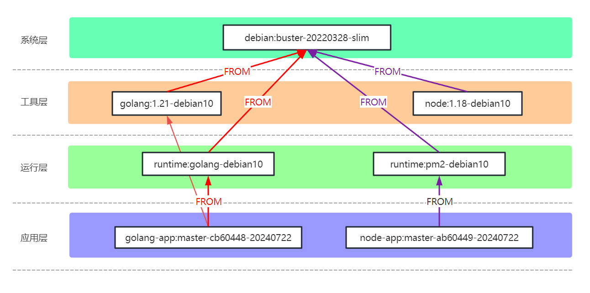

# Kubernetes 集群相关规范

## 镜像使用规范

### 名称定义

名称格式： `name:tag`

- name: 镜像名称，要求人类可读性强。
- tag：镜像 tag，具体格式建议如下:

```
镜像具体版本-上层镜像/其他描述
golang:1.24-debian11
```

名称规范：使用小写字母，并符合正则表达式 `[a-z]([-a-z0-9]*[a-z0-9])?`。
- 这意味着名称必须以小写字母开头。
- 后续字符可以是小写字母、数字或连字符 (`-`)。
- 名称不能以连字符 (`-`) 结尾。

### **Docker 镜像分层设计**

Docker 镜像采用分层设计，能够带来诸多优势，包括：

- **缓存高效**：Docker 在构建镜像时会缓存每一层。如果 Dockerfile 的某一部分没有改变，那么相应的层可以直接从缓存中重用，从而加快构建速度。
- **减少存储空间**：多个镜像可以共享相同的底层镜像层，节省磁盘空间。
- **提高传输效率**：推送和拉取镜像时，只需传输有差异的层，减少网络带宽消耗。
- **逻辑清晰**：将不同功能的指令分离到不同层，使 Dockerfile 结构更清晰，易于维护。



### 基础系统

> 以官方发行版镜像为基础

- debian:bullseye-20250407-slim
- centos:centos7.9.2009

### 编译工具

> 以基础系统为基础，创建编译的镜像
>
> 注意编译环境的系统要和运行环境的系统一致

- common/tools/golang:1.24-debian11

### 运行环境

> 以基础系统为基础，创建应用运行的镜像

- common/runtime/yii:php-8.4
- common/runtime/python:3.11
- common/runtime/golang:debian11

### 业务系统镜像

- 名称格式：`<service_name>:<代码分支>-<commit_id>-<日期时间戳>`
  - `<service_name>`: 服务名称，全小写。
  - `<代码分支>`: 例如 `master`, `dev`, `feature-xxx`。
  - `<commit_id>`: Git 提交哈希的前 7 位短哈希即可，例如 `c26632b`。
  - `<日期时间戳>`: 建议使用 `YYYYMMDDHHMMSS` 格式，例如 `20220114121200` 表示 2022 年 1 月 14 日 12 时 12 分 00 秒。

```
例如：
app-search:master-c26632b-20220114121200
```

- 名称规范：同样要求全部小写，并符合 `[a-z]([-a-z0-9]*[a-z0-9])?` 正则表达式。

## Dockerfile 编写规范

编写 Dockerfile 时，遵循以下规范可以帮助构建出更高效、更安全、更易于维护的镜像。

1. 基础镜像的标签不要用 `latest`, `bullseye` 等模糊指向的标签, 要用具体的版本号。
   这样做是为了保证构建的可复现性和环境的稳定性。`latest` 或通用发行版名称（如 `latest`）可能会在不同时间指向不同的镜像版本，导致构建结果不一致或引入未预期的变更。

```Docker
FROM debian:bullseye-slim
```

2. 使用 `LABEL` 设置镜像元数据。
   元数据有助于镜像管理和追溯，例如维护者信息、版本号、功能描述等。

```Docker
LABEL maintainer="ops@test.com" \\
      description="This is a cool microservice."
```

3. 把变化最少的部分放在 Dockerfile 的前面，这样可以充分利用镜像缓存。
   Docker 按顺序执行 Dockerfile 中的指令，并缓存每条指令成功执行后产生的镜像层。将不经常变动的内容（如基础镜像、系统依赖安装）放在前面，可以使得在后续代码或配置变动时，Docker 能够重用之前的缓存层，从而大幅加快构建速度。

4. 使用多阶段编译 (Multi-stage builds), 且依赖包下载单独放置一层执行。
   多阶段构建允许在一个 Dockerfile 中使用多个 `FROM` 指令。每个 `FROM` 指令可以开始一个新的构建阶段，并可以丢弃之前阶段产生的不需要最终运行的中间产物（如编译工具、临时文件等）。这能显著减小最终镜像的体积，使其仅包含运行时必要的依赖。将依赖包下载（如 `go mod download`, `npm install`, `pip install -r requirements.txt`）单独分层，可以在代码变更但依赖不变时，有效利用 Docker 的缓存机制，进一步加快构建速度。

```Docker
#syntax=harbor.leops.local/library/docker/dockerfile:1

# ---- 编译环境 ----
FROM harbor.leops.local/common/tools/golang:1.24 AS builder

ARG APP_ENV=test \
    APP=undefine \
    GIT_BRANCH= \
    GIT_COMMIT_ID=

ENV APP_ENV=$APP_ENV \
    APP=$APP \
    GIT_BRANCH=$GIT_BRANCH \
    GIT_COMMIT_ID=$GIT_COMMIT_ID

WORKDIR /app_build

# 编译
COPY . .
RUN --mount=type=cache,id=gomod,target=/go/pkg/mod \
  --mount=type=cache,id=gobuild,target=/root/.cache/go-build \
  go build  -tags 'osusergo,netgo' \
  -ldflags "-X main.branch=$GIT_BRANCH -X main.commit=$GIT_COMMIT_ID" \
  -v -o bin/${APP} *.go \
  && cp -rf etc bin/etc \
  && chown 999.999 -R bin

#
# ---- 运行环境 ----
FROM harbor.leops.local/common/runtime/golang:debian11 AS running

ARG APP_ENV=test \
    APP=undefine \
    GIT_BRANCH= \
    GIT_COMMIT_ID=

ENV APP_ENV=$APP_ENV \
    APP=$APP \
    GIT_BRANCH=$GIT_BRANCH \
    GIT_COMMIT_ID=$GIT_COMMIT_ID

WORKDIR /app

COPY --from=builder --link /app_build/bin /app/

CMD ["bash", "-c", "exec /app/${APP} -f /app/etc/app_${APP_ENV}.yaml"]
```

5. 使用 `.dockerignore` 排除不需要的文件和目录。
   `.dockerignore` 文件类似于 `.gitignore`，它定义了在执行 `docker build` 时，哪些文件或目录不应被发送到 Docker 守护进程（构建上下文）。排除不必要的文件（如 `.git` 目录、本地测试脚本、文档、临时文件等）可以减小构建上下文的大小，从而加快构建速度，并避免将敏感信息或不相关文件打包到镜像中。

```
# 注释：说明哪些文件被忽略
.git
.vscode/
*/temp*
*/*/temp*
temp?
*.md
!README.md # 保留 README.md，即使 *.md 被忽略
local_settings.py
```

6. 避免安装不必要的包，构建镜像应该尽可能减少复杂性、依赖关系、构建时间及镜像大小。
   在安装软件包时，使用 `--no-install-recommends` (对于 `apt-get`) 或类似选项可以避免安装推荐但非必需的软件包，这有助于进一步减小镜像体积。

```Docker
RUN apt-get update && apt-get install -y --no-install-recommends wget && rm -rf /var/lib/apt/lists/*
```

7. 每个容器只关心一件事（单一职责原则）。所以最好不要在同个容器启动多个进程。
   这符合微服务和容器化的核心理念，使得容器更轻量、职责更单一、易于管理、监控和水平扩展。如果需要运行多个服务，应考虑使用多个容器并通过 Docker Compose 或 Kubernetes 等编排工具进行管理。

8. 将多个 `RUN` 指令合并为一个，尤其针对连续的文件操作或包安装。
   Dockerfile 中的每个 `RUN` 指令都会创建一个新的镜像层。过多的层会增加镜像的总体积。通过使用 `&&` 和 `\` (续行符) 将多个命令合并到一个 `RUN` 指令中，可以减少层数。

```Docker
RUN apt-get update \\
    && apt-get install -y --no-install-recommends nodejs \\
    && cd /app \\
    && npm install \\
    && npm cache clean --force \\
    && rm -rf /var/lib/apt/lists/* # 清理apt缓存
```

9. 每个 `RUN` 指令（尤其是在安装软件包或处理文件后）后应及时删除多余的临时文件、缓存等。
   例如，`apt-get install` 之后清理 `/var/lib/apt/lists/*`，解压文件后删除原始压缩包等。这可以显著减小该层的大小，从而减小最终镜像的体积。

```Docker
RUN apt-get update \\
    && apt-get install -y --no-install-recommends wget \\
    # 清理apt缓存，删除不必要文件
    && rm -rf /var/lib/apt/lists/*
```

10. 设置 `WORKDIR` 明确默认工作目录。
    `WORKDIR` 指令为 Dockerfile 中后续的 `RUN`, `CMD`, `ENTRYPOINT`, `COPY`, `ADD` 指令设置工作目录。使用 `WORKDIR` 可以使 Dockerfile 更清晰，避免在多个指令中使用冗长的绝对路径。如果指定的目录不存在，`WORKDIR` 会自动创建它。

```Docker
WORKDIR /app
```

11. `COPY` 与 `ADD` 优先使用前者。
    `COPY` 指令的功能更明确和可预测：它仅用于将本地文件或目录复制到容器的文件系统中。
    `ADD` 指令功能更复杂，它支持复制本地文件、自动解压常见的压缩文件（如 tar, gzip, bzip2, xz）以及从 URL 下载文件。然而，这种多功能性有时会导致行为不明确或引入安全风险（例如，从不可信的 URL 下载文件）。因此，除非明确需要 `ADD` 的自动解压或 URL 下载功能，否则应优先使用 `COPY` 以保持 Dockerfile 的简洁和安全。

```Docker
COPY . /app # 将构建上下文的当前目录内容复制到镜像的 /app 目录
```

12. 按需添加 `HEALTHCHECK`，让 Docker 周期性的检查容器的健康状况。
    `HEALTHCHECK` 指令告诉 Docker 如何测试容器以检查其是否仍在工作。这可以检测到例如 Web 服务器卡死但进程未退出的情况。Docker 守护进程会定期运行健康检查命令，并根据其退出状态更新容器的健康状态。这对于容器编排系统（如 Kubernetes、Docker Swarm）非常有用，它们可以根据健康状况来重启不健康的容器或停止向其发送流量。

```Docker
# 这个视情况而定是否要添加，确保 $APP_PORT 环境变量已设置
# HEALTHCHECK --interval=30s --timeout=3s --start-period=5s --retries=3 \\
#  CMD curl --fail http://localhost:$APP_PORT/healthz || exit 1
```

> 注意：上述 `HEALTHCHECK` 示例中的 `/healthz` 路径和端口 `$APP_PORT` 需要根据实际应用进行调整。

13. 设置默认的环境变量 (`ENV`)，映射端口 (`EXPOSE`) 和数据卷 (`VOLUME`)。
    - `ENV`: 设置环境变量，这些变量可以在容器运行时被应用访问。
    - `EXPOSE`: 声明容器在运行时会监听的网络端口。这主要起到文档作用，实际端口映射仍需在 `docker run` 时通过 `-p` 或 `-P` 参数指定。
    - `VOLUME`: 创建一个挂载点，并将其标记为持有外部挂载的卷或由容器管理的数据。

```Docker
ENV MEDIA_DIR=/media \\
    NODE_ENV=production \\
    APP_PORT=3000

VOLUME $MEDIA_DIR
EXPOSE $APP_PORT
```

14. 使用非 root 用户运行容器。
    默认情况下，容器内的进程以 root 用户身份运行。这是一个潜在的安全风险，因为如果容器内的进程被攻破，攻击者可能会获得容器乃至宿主机的 root 权限。通过创建并切换到一个非 root 用户，可以遵循最小权限原则，增强容器的安全性。

```Docker
# 创建一个普通用户组和用户，例如 'appuser'
RUN groupadd -r appgroup && useradd --no-log-init -r -g appgroup appuser

# 如果需要特定UID/GID，可以指定，例如 999
# RUN groupadd -g 999 appgroup && useradd --no-log-init -r -u 999 -g appgroup appuser

# 将工作目录及相关文件的所有权赋予新用户 (如果适用)
# WORKDIR /app
# COPY --chown=appuser:appgroup . .

USER appuser:appgroup # 或者 USER appuser
```

> 注意：确保应用文件对于此非 root 用户是可读/可执行的。某些基础镜像可能已包含非 root 用户，可直接使用。

15. `CMD` 或 `ENTRYPOINT` 指令优先使用 exec 格式（JSON 数组格式）。
    `CMD` 和 `ENTRYPOINT` 都有两种格式：shell 格式和 exec 格式。
    - Shell 格式: `CMD command param1 param2` (会被 `/bin/sh -c` 包裹执行)
    - Exec 格式: `CMD ["executable","param1","param2"]`
      推荐使用 Exec 格式，因为它会直接执行指定的可执行文件，并且该进程将作为容器中的 PID 1。这使得它能够正确接收和处理来自 Docker 守护进程的信号（如 `SIGTERM` 用于优雅关闭）。而 Shell 格式下，应用进程通常不是 PID 1，可能无法正确处理信号。

```Docker
CMD [ "/bin/echo", "hello docker" ]
# 或者
# ENTRYPOINT [ "/usr/sbin/nginx", "-g", "daemon off;" ]
```

## 镜像仓库使用规范

> 使用 [harbor](https://github.com/goharbor/harbor)开源仓库

### 仓库分类

- library：开源软件的镜像
- common: 基础镜像，共同使用的镜像
- infrastructure: 基础设施的镜像
- dev： 开发环境使用的仓库
- test： 测试环境使用的仓库
- prod：生产环境使用的仓库
- thirdparty: 第三方应用使用的仓库

### 仓库生命周期

- library：一直保留。
- common: 一直保留。
- infrastructure： 一直保留。
- dev：保留 1 周(只保留 1周内下载的镜像，latest镜像，最近7个tag)。
- test： 保留 1 月(只保留 1月内下载的镜像，latest镜像，最近15个tag)。
- prod：保留 3 月(只保留 3月内下载的镜像，latest镜像，最近30个tag)。
- thirdparty: 一直保留。

### 仓库权限

- 最小化权限授权，环境仓库有独立的账号密码。
- common，infrastructure， library： 开放读权限。
- test，prd： 镜像必须从 CI 上构建推送。

### 账号权限

| 账号/仓库 | library | common | infrastructure | dev | test | prod | thirdparty | 说明     |
| --------- | ------- | ------ | -------------- | --- | ---- | ---- | ---------- | -------- |
| build     | RW      | RW     | RW             | RW  | RW   | RW   | RW         | 编译使用 |
| dev       | R       | R      | R              | RW  | R    | R    | x          | 开发使用 |
| test      | R       | R      | R              | x   | R    | x    | R          | 测试使用 |
| prod      | R       | R      | R              | x   | x    | R    | R          | 生产使用 |

## K8S 集群使用规范

### 集群节点

- cpu 内存： 1:4 比例，16c64g，24c96g。
- 系统盘：SSD 云盘 120G，数据盘：SSD 云盘 500G。

### 命名空间

- `infrastructure` 业务依赖的基础设施，如 consul，apollo,  apisix,  opentelemetry
- `business-业务名称`业务线应用
- `kube-monitor`  集群监控

### **资源名称规范**

- 格式： 环境标识-资源名称
- 名称小写，符合 `[a-z]([-a-z0-9]*[a-z0-9])?` 正则表达式

### Deployment 编写规范

1. 资源名称

   - 格式： 环境标识-资源名称

   - 名称小写，符合 `[a-z]([-a-z0-9]*[a-z0-9])?` 正则表达式


```YAML
metadata:
  name: test-app
```

2. labels

   - label 必须以字母或数字开头，可以使用字母、数字、连字符、点和下划线，最长 40 个字符。

   - label 需小写。


```YAML
  labels:
    business: mall    # 系统产品业务线：mall
    language: golang  # 系统语言：golang
    app: test-app     # 应用：test-app
    app_tag: ""       # 应用tag: x-blue
    app_env: test     # 环境：test
```

3. 副本

   - 测试环境：默认 2 个副本

   - 生产环境：默认 3 个副本

   - 其他要求，联系运维另行配置


```YAML
spec:
  replicas: 2
```

4. 容器名称
   - 使用应用名称，名称小写。

5. 挂载宿主机时区

```YAML
spec:
  template:
    spec:
      volumes:
        - name: volume-localtime
          hostPath:
            path: /usr/share/zoneinfo/Asia/Shanghai
            type: ''
      containers:
        - name: app
          env:
            - name: TZ
              value: Asia/Shanghai
          volumeMounts:
            - name: volume-localtime
              mountPath: /etc/localtime
```

5. 设置环境变量
   - 环境变量 key 使用大写，value 不限制。


```yaml
spec:
  template:
    spec:
      containers:
        - name: app
          env:
            - name: APP_ENV
              value: test
            - name: APP_TAG
              value: ''
```

取消 Service 变量注入, 这里可根据应用情况决定是否关闭（pm2 应用一定要关闭）

```yaml
spec:
  template:
    spec:
      enableServiceLinks: false
```

6. 资源限制

   - 资源比例为 1:2， 限制 2c4Gi，请求 1c2Gi，适用于内存和 CPU 都需要的应用。

   - 资源比例为 1:4， 限制 1c4Gi，请求 250m1Gi：适用于内存资源大，cpu 使用少的应用。

   - 默认配置：测试环境(限制 1c2Gi，请求 250m500Mi), 生产环境(限制 2c4Gi，请求 1c2Gi)

   - 对于重要应用：请求和限制需一致。其他特殊需求，请联系值班运维协助配置。


```YAML
spec:
  template:
    spec:
      containers:
        - name: app
          resources:
            limits:
              cpu: 2
              memory: 4Gi
            requests:
              cpu: 1
              memory: 2Gi
```

7. 端口配置
   - 名称为服务类型，api，rpc，promtheus


```YAML
spec:
  template:
    spec:
      containers:
        - name: app
          ports:
            - name: api
              containerPort: 8888
              protocol: TCP
```

8. 监测机制

http 应用

```YAML
spec:
  template:
    spec:
      containers:
        - name: app
          livenessProbe:     # 存活检测
            httpGet:
              path: /healthz
              port: 8888
              scheme: HTTP
            initialDelaySeconds: 2
            timeoutSeconds: 3
            periodSeconds: 10
            successThreshold: 1
            failureThreshold: 3
          readinessProbe:     # 就绪监测
            httpGet:
              path: /healthz
              port: 8888
              scheme: HTTP
            initialDelaySeconds: 2
            timeoutSeconds: 3
            periodSeconds: 5
            successThreshold: 1
            failureThreshold: 3
```

grpc 应用

```yaml
spec:
  template:
    spec:
      containers:
        - name: app
          livenessProbe:
            grpc:
              port: 8080
              service: ''
            failureThreshold: 3
            initialDelaySeconds: 2
            periodSeconds: 10
            successThreshold: 1
            timeoutSeconds: 3
          readinessProbe:
            grpc:
              port: 8080
              service: ''
            failureThreshold: 3
            initialDelaySeconds: 2
            periodSeconds: 3
            successThreshold: 1
            timeoutSeconds: 3
```


9. 生命周期

> 在 pod 关闭前，预留一段时间给应用处理流量。具体时间可根据应用而设定。

```YAML
spec:
  template:
    spec:
      containers:
        - name: app
          lifecycle:
            preStop:
              exec:
                command:
                 - /bin/sh
                 - -c
                 - "sleep 10"
       terminationGracePeriodSeconds: 60
```

10. 反亲和性

    > 让应用实例更分散的分布在集群节点上

```YAML
spec:
  template:
    spec:
      affinity:
        podAntiAffinity:  # pod 弱亲和性
          preferredDuringSchedulingIgnoredDuringExecution:
          - podAffinityTerm:
              labelSelector:
                matchExpressions:
                - key: app
                  operator: In
                  values:
                  - test-app
              topologyKey: "kubernetes.io/hostname"
            weight: 100
```

11. 升级策略和历史资源限制

```YAML
spec:
  strategy:
    type: RollingUpdate    # 滚动更新
    rollingUpdate:
      maxUnavailable: 25%
      maxSurge: 25%
  revisionHistoryLimit: 3
  progressDeadlineSeconds: 600
```

12. 镜像配置

    - 镜像下载为：Always 总是下载

    - 镜像重启为：restartPolicy 遇到错误总是重启

    - 镜像下载认证： 环境-hub 提供者

    ```yaml
    spec:
      template:
        spec:
          containers:
            - name: app
              imagePullPolicy: Always
              restartPolicy: Always
              imagePullSecrets:
                - name: test-harbor
    ```

13. 安全配置

    - 使用非root账号运行程序

    ```yaml
    spec:
      template:
        spec:
          containers:
            - name: app
              securityContext:
                runAsUser: 999
                runAsNonRoot: true
                allowPrivilegeEscalation: false
    ```

    

### StatefulSets 编写规范

1. 名称

   - 格式： 环境标识-资源名称

   - 名称小写，符合 `[a-z]([-a-z0-9]*[a-z0-9])?` 正则表达式


```YAML
metadata:
  name: test-app
```

2. labels

   - label 必须以字母或数字开头，可以使用字母、数字、连字符、点和下划线，最长 40 个字符。

   - label 需小写。


```YAML
  labels:
    business: mall    # 系统产品业务线：mall
    language: golang  # 系统语言：golang
    app: test-app     # 应用：test-app
    app_tag: ""       # 应用tag: x-blue
    app_env: test     # 环境：test
```

3. 副本

   - 测试环境：默认 2 个副本

   - 生产环境：默认 3 个副本

   - 其他要求，另行配置


```YAML
spec:
  replicas: 2
```

4. 容器名称

   - 使用应用名称，名称小写。
4. 挂载宿主机时区

```YAML
spec:
  template:
    spec:
      volumes:
        - name: volume-localtime
          hostPath:
            path: /usr/share/zoneinfo/Asia/Shanghai
            type: ''
      containers:
        - name: app
          env:
            - name: TZ
              value: Asia/Shanghai
          volumeMounts:
            - name: volume-localtime
              mountPath: /etc/localtime
```

5. 设置环境变量

- 环境变量 key 使用大写，value 不限制。

```YAML
spec:
  template:
    spec:
      containers:
        - name: app
          env:
            - name: APP_ENV
              value: test
            - name: APP_TAG
              value: ""
```

取消 Service 变量注入, 这里可根据应用情况决定是否关闭（pm2 应用一定要关闭）

```yaml
spec:
  template:
    spec:
      enableServiceLinks: false
```

6. 资源限制

   - 资源比例为 1:2， 限制 2c4Gi，请求 1c2Gi，适用于内存和 CPU 都需要的应用。

   - 资源比例为 1:4， 限制 1c4Gi，请求 250m1Gi：适用于内存资源大，cpu 使用少的应用。

   - 默认配置：测试环境(限制 1c2Gi，请求 250m500Mi), 生产环境(限制 2c4Gi，请求 1c2Gi)

   - 对于重要应用，请求和限制需一致。其他特殊需求，请联系值班运维协助配置。


```YAML
spec:
  template:
    spec:
      containers:
        - name: app
          resources:
            limits:
              cpu: 2
              memory: 4Gi
            requests:
              cpu: 1
              memory: 2Gi
```

7. 端口配置
   - 名称为服务类型，api，rpc，promtheus


```YAML
spec:
  template:
    spec:
      containers:
        - name: app
          ports:
            - name: api
              containerPort: 8888
              protocol: TCP
```

8. 监测机制

http 应用

```YAML
spec:
  template:
    spec:
      containers:
        - name: app
          livenessProbe:     # 存活检测
            httpGet:
              path: /healthz
              port: 8888
              scheme: HTTP
            initialDelaySeconds: 2
            timeoutSeconds: 3
            periodSeconds: 10
            successThreshold: 1
            failureThreshold: 3
          readinessProbe:     # 就绪监测
            httpGet:
              path: /healthz
              port: 8888
              scheme: HTTP
            initialDelaySeconds: 2
            timeoutSeconds: 3
            periodSeconds: 5
            successThreshold: 1
            failureThreshold: 3
```

grpc 应用

```yaml
spec:
  template:
    spec:
      containers:
        - name: app
          livenessProbe:
            grpc:
              port: 8080
              service: ''
            failureThreshold: 3
            initialDelaySeconds: 2
            periodSeconds: 10
            successThreshold: 1
            timeoutSeconds: 3
          readinessProbe:
            grpc:
              port: 8080
              service: ''
            failureThreshold: 3
            initialDelaySeconds: 2
            periodSeconds: 3
            successThreshold: 1
            timeoutSeconds: 3
```

9. 生命周期

> 在 pod 关闭前，预留一段时间给应用处理流量。具体时间可根据应用而设定。

```YAML
spec:
  template:
    spec:
      containers:
        - name: app
          lifecycle:
            preStop:
              exec:
                command:
                 - /bin/sh
                 - -c
                 - "sleep 10"
       terminationGracePeriodSeconds: 60
```

10. 反亲和性

> 让应用实例更分散的分布在集群节点上

```YAML
spec:
  template:
    spec:
      affinity:
        podAntiAffinity:  # pod 弱亲和性
          preferredDuringSchedulingIgnoredDuringExecution:
          - podAffinityTerm:
              labelSelector:
                matchExpressions:
                - key: app
                  operator: In
                  values:
                  - test-app
              topologyKey: "kubernetes.io/hostname"
            weight: 100
```

11. 升级策略和历史资源限制

```YAML
spec:
   updateStrategy:
     type: RollingUpdate
   revisionHistoryLimit: 3
```

12. 镜像配置

    - 镜像下载为：Always 总是下载

    - 镜像重启为：restartPolicy 遇到错误总是重启

    - 镜像下载认证： 环境-hub 提供者


```YAML
spec:
  template:
    spec:
      containers:
        - name: app
          imagePullPolicy: Always
          restartPolicy: Always
          imagePullSecrets:
            - name: test-harbor
```

13. 安全配置

    - 使用非root账号运行程序

    ```yaml
    spec:
      template:
        spec:
          containers:
            - name: app
              securityContext:
                runAsUser: 999
                runAsNonRoot: true
                allowPrivilegeEscalation: false
    ```

### **Service 编写规范**

1. 名称

   - 格式： 环境标识-资源名称

   - 名称小写，符合 `[a-z]([-a-z0-9]*[a-z0-9])?` 正则表达式


```YAML
metadata:
  name: test-app # 环境-名称
```

2. label
   -  kv 与 对应的资源服务对齐


```YAML
  labels:
    business: mall    # 系统产品业务线：mall
    language: golang  # 系统语言：golang
    app: test-app     # 应用：test-app
    app_tag: ""       # 应用tag: x-blue
    app_env: test     # 环境：test
```

### **Ingress 编写规范**

1. 名称

   - 格式： 环境标识-资源名称

   - 名称小写，符合 `[a-z]([-a-z0-9]*[a-z0-9])?` 正则表达式


```YAML
metadata:
  name: test-app # 环境-名称
```

2. label 
   -  kv 与 对应的资源服务对齐


```YAML
  labels:
    business: mall    # 系统产品业务线：mall
    language: golang  # 系统语言：golang
    app: test-app     # 应用：test-app
    app_tag: ""       # 应用tag: x-blue
    app_env: test     # 环境：test
```

3. 明确指出 ingress class

```YAML
spec:
  ingressClassName: nginx
```

### 存储使用

1. 阿里云云盘限制

```
高效云盘：最小20 GiB。
SSD云盘：最小20 GiB。
ESSD云盘：最小20 GiB。

nas使用限制：https://help.aliyun.com/document_detail/147695.htm?spm=a2c4g.11186623.0.0.21267d75QzdHWQ#concept-2371449
```

2. 名称定义
   - 格式： 环境-APP名称-类型-pvc


```
test-app-cnfs-nas-pvc
test-app-disk-essd-pvc
```

3. sts 应用使用 essd 存储。

> 不需要共享的，使用 essd 磁盘，块存储性能高。

```YAML
 ---
 apiVersion: apps/v1
 kind: StatefulSet
 metadata:
   name: test-app
 spec:
   template:
     spec:
       containers:
       - name: app
         volumeMounts:
         - name: app-disk-ssd
           mountPath: /data
   volumeClaimTemplates:
   - metadata:
       name: test-app-disk-essd-pvc
     spec:
       accessModes: [ "ReadWriteOnce" ]
       storageClassName: "alicloud-disk-essd"
       resources:
         requests:
           storage: 20Gi
```

4. deployment 应用使用 nas 共享存储。

> 需要共享的，使用 nas 存储。如使用阿里云块存储需要注意多读多写。

```YAML
---
kind: PersistentVolumeClaim
apiVersion: v1
metadata:
  name: test-app-cnfs-nas-pvc
spec:
  accessModes:
  - ReadWriteMany
  storageClassName: alibabacloud-cnfs-nas
  resources:
    requests:
      storage: 1Gi

---
apiVersion: apps/v1
kind: Deployment
spec:
  template:
    spec:
      containers:
      - name: app
        volumeMounts:
        - mountPath: /data
          name: app-storage
          readOnly: false
      volumes:
      - name: app-storage
        persistentVolumeClaim:
          claimName: test-app-cnfs-nas-pvc
```

### 网络使用

1. 使用全限定域名

```
service 资源
<service_name>.<namespace>.svc.<cluster domain>.

如：
my-svc.my-namespace.svc.cluster.local.
pod-ip-address.my-svc.my-namespace.svc.cluster.local.
```

## K8S 应用规范

### 环境变量

- 支持 `APP_ENV` 环境变量注入来获取不同环境的配置。
- 支持 `APP_TAG` 环境变量注入来获取不同环境的标签。

### 服务端口

- api 服务：**8888**
- rpc 服务：**8080**
- promtheus exporter：**9091**

### 信号处理

- 进程接收 `SIGTERM` 信号后进程做退出处理

### 健康检查

1. api 服务

> http code 200 为检查通过，其他则为不通过。

普通检查

```Bash
# curl -i http://localhost:8080/healthz
HTTP/1.1 200 OK
Date: Tue, 12 Apr 2022 09:45:43 GMT
Content-Type: text/html;charset=utf-8
Content-Length: 343
Connection: keep-alive
Server: go

[+]ping ok

healthz check passed
```

详细检查, 检查所有依赖项

```Bash
# curl -i http://localhost:8080/healthz?verbose
HTTP/1.1 200 OK
Date: Tue, 12 Apr 2022 09:45:43 GMT
Content-Type: text/html;charset=utf-8
Content-Length: 343
Connection: keep-alive
Server: go

[+]ping ok
[+]log ok
[+]consul: ok
[+]apollo: ok
[+]elasticsearch: ok
[+]mysql: ok
[+]redis: ok

healthz check passed
```

2. grpc 健康检查

业务代码需使用 [GRPC 健康检查协议](https://github.com/grpc/grpc/blob/master/doc/health-checking.md) 来实现一个 gRPC 方法

使用 [grpc_health_probe](https://github.com/grpc-ecosystem/grpc-health-probe) 命令行实用程序生成 RPC 到 `/grpc.health.v1.Health/Check`. 如果它以 `SERVING`状态响应，`grpc_health_probe`它将成功退出，否则它将以非零退出代码退出。

```Bash
$ grpc_health_probe -addr=localhost:9090
healthy: SERVING

$ grpc_health_probe -addr=localhost:9090 -connect-timeout 250ms -rpc-timeout 100ms
failed to connect service at "localhost:9999": context deadline exceeded
exit status 2
```

### 配置

> 按需选择

https://www.apolloconfig.com/#/zh/deployment/quick-start

https://nacos.io/docs/latest/overview/

### 监控

**指标抓取**

使用 [prometheus](<%5BGitHub%20-%20prometheus/prometheus:%20The%20Prometheus%20monitoring%20system%20and%20time%20series%20database.%5D(https://github.com/prometheus/prometheus)>) 来抓取指标

- Port: 9091
- Path: /metrics

**Trace 调用链**

> 根据应用情况来添加

https://opentelemetry.io/

**持续性能分析**

> 根据应用情况来添加

https://grafana.com/docs/pyroscope/latest/


### 日志输出

- 结构体以 `json` 格式输出

> 注意：文本中如有换行符需替换，保持一行一条日志信息。以下字段必备，其他字段可以按应用自行增加

```JSON
{
    "@timestamp": "2020-09-12T01:22:55.552+08",
    "level": "info",
    "content": "sql query:..."
}
```

- 输出方式

输出到终端 **console 或文件中。**

- 日志抓取

默认抓取应用的终端输出，其他需要联系值班运维协助。
