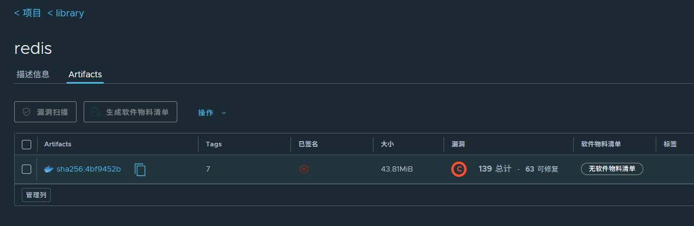
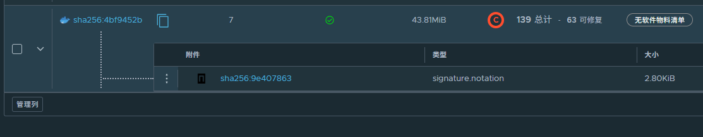

# 使用 Notation 对 Harbor 镜像进行签名

## 概述

本文档将指导您如何使用 [Notation CLI](https://notaryproject.dev/docs/notary-project-overview/) 对存储在 Harbor 注册表中的容器镜像进行数字签名和验证。Notation 是 Notary Project 的 CLI 实现工具，遵循 OCI 标准，为容器镜像提供数字签名功能，确保软件供应链的安全性。

通过镜像签名，您可以：

- 验证镜像的完整性和来源
- 确保镜像在传输和存储过程中未被篡改
- 实现基于信任策略的镜像部署控制

## 前置条件

在开始之前，请确保您的环境满足以下要求：

- 已部署并配置好的 Harbor
- Docker 客户端已安装并配置
- 具有 Harbor 注册表的管理员或推送权限
- Linux/macOS/Windows 操作系统环境

## 安装 Notation CLI

```bash
# 下载最新版本的 Notation CLI
wget https://github.com/notaryproject/notation/releases/download/v1.3.2/notation_1.3.2_linux_amd64.tar.gz

# 解压安装包
tar -zxvf notation_1.3.2_linux_amd64.tar.gz

# 移动到系统路径
sudo mv notation /usr/local/bin/

# 验证安装
notation version
```

### 验证安装

```bash
# 检查 Notation 版本
notation version

# 查看帮助信息
notation --help
```

## 密钥管理

### 生成测试签名密钥

> **注意**：以下生成的是测试密钥，仅适用于开发和测试环境。生产环境建议使用正式的 CA 证书或硬件安全模块（HSM）。

```bash
# 生成测试证书和密钥，请将 "harbor.leops.local" 替换为您的 Harbor 域
# 注意: 证书有效期只有1天
notation cert generate-test --default "harbor.leops.local"
```

该命令将：

- 生成一个自签名的测试证书
- 创建相应的私钥文件
- 自动将证书设置为默认签名证书

也可以使用 openssl 生成长时间证书和密钥，并配置到 Notation 中

```bash
name="harbor.leops.local"
openssl req -x509 -sha256 -nodes -newkey rsa:2048 -keyout $name.key -out $name.crt -days 365 -subj "/C=US/ST=WA/L=Seattle/O=Notary/CN=$name" -addext "basicConstraints=CA:false" -addext "keyUsage=critical,digitalSignature" -addext "extendedKeyUsage=codeSigning"
notation cert add --type ca --store harbor.leops.local $name.crt

cp $name.key /root/.config/notation/localkeys/$name.key
cp $name.crt /root/.config/notation/localkeys/$name.crt

cat <<EOF > /root/.config/notation/signingkeys.json
{
    "default": "harbor.leops.local",
    "keys": [
        {
            "name": "harbor.leops.local",
            "keyPath": "/root/.config/notation/localkeys/harbor.leops.local.key",
            "certPath": "/root/.config/notation/localkeys/harbor.leops.local.crt"
        }
    ]
}
EOF
```

### 查看和管理密钥

生成密钥后，您可以查看已配置的密钥和证书：

```bash
# 查看所有密钥
notation key list

# 示例输出：
# NAME                    KEY PATH                                                   CERTIFICATE PATH                                           ID   PLUGIN NAME
# * harbor.leops.local   /root/.config/notation/localkeys/harbor.leops.local.key   /root/.config/notation/localkeys/harbor.leops.local.crt

# 查看证书存储
notation cert list

# 示例输出：
# STORE TYPE   STORE NAME            CERTIFICATE
# ca           harbor.leops.local   harbor.leops.local.crt
```

输出说明：

- `*` 表示默认密钥
- `KEY PATH`: 私钥文件存储路径
- `CERTIFICATE PATH`: 证书文件存储路径
- `STORE TYPE`: 证书存储类型（ca 表示证书颁发机构）

## Harbor 认证配置

### 方式一：环境变量认证（推荐）

```bash
# 设置 Harbor 认证信息
export NOTATION_USERNAME="admin"
export NOTATION_PASSWORD="your-harbor-password"
```

### 方式二：使用 notation login 命令

```bash
# 登录到 Harbor 注册表
notation login harbor.leops.local

# 系统会提示输入用户名和密码
# Username: admin
# Password: [hidden]
# Login Succeeded
```

### 方式三：使用 Docker 凭据

如果您已经通过 Docker 登录了 Harbor，Notation 可以复用这些凭据：

```bash
# 首先通过 Docker 登录
docker login harbor.leops.local

# Notation 会自动使用 Docker 的凭据
```

### 验证认证状态

```bash
# 或者尝试列出远程仓库的签名（需要认证）
notation list harbor.leops.local/library/test-image:latest
```

## 镜像操作流程

### 准备测试镜像

首先，我们需要准备一个测试镜像并推送到 Harbor 注册表：

```bash
# 拉取测试镜像（以 Redis 为例）
docker pull redis:7

# 为镜像打标签，指向您的 Harbor 注册表
# 格式：harbor.domain.com/project/image:tag
docker tag redis:7 harbor.leops.local/library/redis:7

# 推送镜像到 Harbor
# 确保您已经通过 docker login 登录到 Harbor
docker push harbor.leops.local/library/redis:7
```

推送成功后，您可以在 Harbor 的 Web 界面中看到镜像：



### 获取镜像 Digest

在签名之前，我们需要获取镜像的 SHA256 摘要值：

```bash
docker image inspect --format='{{index .RepoDigests 1}}' harbor.leops.local/library/redis:7
```

示例输出：

```
harbor.leops.local/library/redis@sha256:4bf9452b5424f2d5b3726e97d3201785c4f28cd09683b9fcb8677c3a92320630
```

### 对镜像进行签名

使用获取到的镜像 digest 进行签名：

```bash
# 使用镜像的 SHA256 值进行签名
# --force-referrers-tag=false 参数表示不使用 referrers tag 存储签名
notation sign --force-referrers-tag=false --insecure-registry harbor.leops.local/library/redis@sha256:4bf9452b5424f2d5b3726e97d3201785c4f28cd09683b9fcb8677c3a92320630
```

成功签名后的输出：

```
Successfully signed harbor.leops.local/library/redis@sha256:4bf9452b5424f2d5b3726e97d3201785c4f28cd09683b9fcb8677c3a92320630
```

签名完成后，在 Harbor 界面中可以看到签名信息：



### 签名参数说明

- `--insecure-registry`: 使用 http 协议链接 registry
- `--force-referrers-tag=false`: 禁用 referrers tag，使用 OCI 1.1 的 referrers API
- 也可以使用 `--allow-referrers-api` 来启用 referrers API
- 对于不支持 OCI 1.1 的注册表，可以去掉此参数使用传统的 tag 方式存储签名

### 常见签名选项

```bash
# 基本签名
notation sign --insecure-registry <image-reference>

# 指定插件签名
notation sign --plugin <plugin-name> <image-reference>

# 添加用户属性
notation sign --user-metadata key1=value1 --user-metadata key2=value2 <image-reference>

# 使用特定密钥签名
notation sign --key <key-name> <image-reference>
```

### 查看签名信息

签名完成后，可以查看镜像的签名详情：

```bash
# 列出镜像的所有签名
notation list --insecure-registry harbor.leops.local/library/redis@sha256:4bf9452b5424f2d5b3726e97d3201785c4f28cd09683b9fcb8677c3a92320630
```

示例输出：

```
harbor.leops.local/library/redis@sha256:4bf9452b5424f2d5b3726e97d3201785c4f28cd09683b9fcb8677c3a92320630
└── application/vnd.cncf.notary.signature
    └── sha256:9e4078635fdbce76a4fe71fa641eed6ea82ae21805076b73d60ff420129f5318
```

输出说明：

- 第一行显示镜像的完整引用
- `application/vnd.cncf.notary.signature` 表示 Notary 签名格式
- 最后一行是签名本身的 SHA256 值

### 检查签名详情

```bash
# 检查签名的详细信息
notation inspect --insecure-registry harbor.leops.local/library/redis@sha256:4bf9452b5424f2d5b3726e97d3201785c4f28cd09683b9fcb8677c3a92320630
```

## 信任策略配置

信任策略定义了哪些签名被认为是可信的。在验证签名之前，需要配置适当的信任策略。

### 创建信任策略文件

```bash
# 创建信任策略配置文件
cat <<EOF > ./trustpolicy.json
{
    "version": "1.0",
    "trustPolicies": [
        {
            "name": "harbor-images-policy",
            "registryScopes": [ "*" ],
            "signatureVerification": {
                "level": "strict"
            },
            "trustStores": [ "ca:harbor.leops.local" ],
            "trustedIdentities": [
                "*"
            ]
        }
    ]
}
EOF
```

### 信任策略参数详解

| 参数                          | 说明                         | 可选值                                                                  |
| ----------------------------- | ---------------------------- | ----------------------------------------------------------------------- |
| `name`                        | 策略名称，用于标识此策略     | 任意字符串                                                              |
| `registryScopes`              | 适用的注册表范围，支持通配符 | `["*"]` 表示所有注册表                                                  |
| `signatureVerification.level` | 签名验证级别                 | `strict`（严格）、`permissive`（宽松）、`audit`（审计）、`skip`（跳过） |
| `trustStores`                 | 信任的证书存储               | `ca:<store-name>` 格式                                                  |
| `trustedIdentities`           | 信任的身份标识               | `["*"]` 表示信任所有身份                                                |

### 验证级别说明

- **strict**：严格模式，必须有有效签名才能通过验证
- **permissive**：宽松模式，允许无签名的镜像，但如果有签名则必须有效
- **audit**：审计模式，记录验证结果但不阻止操作
- **skip**：跳过验证

### 导入信任策略

```bash
# 导入信任策略到 Notation
notation policy import ./trustpolicy.json

# 验证策略导入是否成功
notation policy show
```

## 签名验证

配置信任策略后，就可以验证镜像签名了：

### 基本验证

```bash
# 验证镜像签名
notation verify --insecure-registry harbor.leops.local/library/redis@sha256:4bf9452b5424f2d5b3726e97d3201785c4f28cd09683b9fcb8677c3a92320630
```

成功验证的输出：

```
Successfully verified signature for harbor.leops.local/library/redis@sha256:4bf9452b5424f2d5b3726e97d3201785c4f28cd09683b9fcb8677c3a92320630
```

### 详细验证输出

```bash
# 使用详细模式查看验证过程
notation verify --insecure-registry --verbose harbor.leops.local/library/redis@sha256:4bf9452b5424f2d5b3726e97d3201785c4f28cd09683b9fcb8677c3a92320630
```

## 最佳实践

### 1. 生产环境建议

- 使用正式的 CA 证书而非自签名证书
- 实施密钥轮换策略
- 使用 HSM 或密钥管理服务
- 设置严格的信任策略
- 定期审计签名状态

### 2. CI/CD 集成

```bash
# 在 CI/CD 流水线中自动签名
#!/bin/bash
set -e

# 构建镜像
docker build -t $IMAGE_NAME .

# 推送镜像
docker push $IMAGE_NAME

# 获取镜像 digest
DIGEST=$(docker inspect --format='{{index .RepoDigests 1}}' $IMAGE_NAME)

# 签名镜像
notation sign --insecure-registry $DIGEST

echo "Image signed successfully: $DIGEST"
```

### 3. 安全考虑

- 保护私钥文件的访问权限
- 使用环境变量而非硬编码存储凭据
- 定期更新 Notation CLI 版本
- 监控签名验证日志

通过以上步骤，您已经成功配置了 Harbor 镜像签名系统。这不仅提高了容器镜像的安全性，还为您的软件供应链提供了可靠的完整性保证。

---

- [Harbor 官方文档](https://goharbor.io/docs/2.13.0/)
- [Notation 官方文档](https://notaryproject.dev/docs/notary-project-overview/)
- [Notaion Github](https://github.com/notaryproject/notation)
